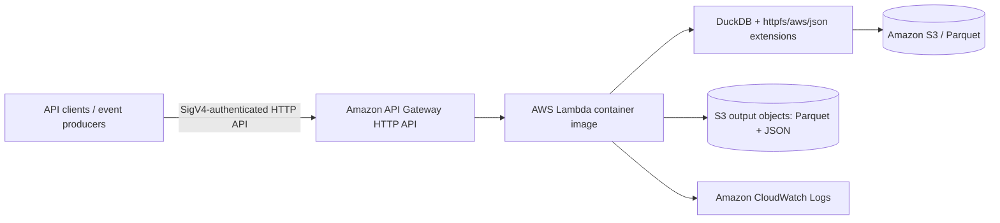

# DuckDB on AWS Lambda

A serverless analytics sample that queries Parquet data in Amazon S3 using DuckDB inside an AWS Lambda container image.

This project demonstrates a practical pattern for running analytical SQL workloads on low-cost serverless infrastructure while keeping the data set in S3 and avoiding a full database deployment.

## Demo prerequisites

Before running the sample end-to-end, make sure you have:

- Python 3.11 or 3.12 installed locally
- A working Docker daemon for building the Lambda container image
- AWS CLI v2 configured with valid credentials for your account
- Terraform 1.5+ installed
- An AWS account with permission to create ECR, Lambda, API Gateway, IAM, S3, and CloudWatch resources
- Access to a target S3 bucket and prefixes that match the sample configuration in `.env.example`

The example assumes you are working from a local machine with AWS access enabled for the same account and region used in the deployment.

## Architecture



## What this implementation does

- Reads Parquet files directly from S3 using DuckDB
- Aggregates `country`, `product_category`, `quantity`, and `unit_price` data
- Writes result objects back to S3 as deterministic Parquet/JSON outputs
- Supports API Gateway HTTP API access with AWS IAM as the default auth option
- Reuses a warm DuckDB connection within a single Lambda execution environment
- Safely processes multiple S3 event records and logs partial failures

## Supported API parameters

The summary route accepts only these query parameters:

- `country` — exact case-insensitive country string, maximum 100 characters
- `year` — integer year that is matched against the dataset's `order_date` column

Examples:

```text
GET /sales/summary?country=US&year=2026
GET /sales/summary?year=2025
```

Query validation behavior:

- Unknown parameters are rejected with HTTP 400
- Empty or malformed `country` values are rejected
- Invalid or out-of-range `year` values are rejected
- The filter is applied in SQL with bound parameters rather than string interpolation

## Error responses

The HTTP summary route returns:

- `200 OK` for valid requests
- `400 Bad Request` for invalid query inputs
- a JSON error payload such as:

```json
{
  "status": "error",
  "error": "Unsupported query parameter: region"
}
```

The S3 event path returns a summary payload with `processed_records`, `failed_records`, and `results` when more than one record is processed.

## AWS IAM authentication

The Terraform configuration default is AWS IAM authorization for the API Gateway HTTP API route. This is the recommended production mode.

Production behavior:

- default route authorization: `AWS_IAM`
- public unauthenticated demo mode: set `allow_public_demo = true` explicitly
- no credentials are stored in source control or environment files

Example signed-request pattern using Python and SigV4:

```python
import boto3
import requests
from botocore.auth import SigV4Auth
from botocore.awsrequest import AWSRequest

session = boto3.Session(region_name="us-east-1")
creds = session.get_credentials().get_frozen_credentials()
url = "https://<api-id>.execute-api.us-east-1.amazonaws.com/sales/summary?country=US&year=2026"
request = AWSRequest(method="GET", url=url)
SigV4Auth(creds, "execute-api", "us-east-1").add_auth(request)
response = requests.get(url, headers=request.headers, timeout=30)
print(response.status_code)
print(response.json())
```

## DuckDB connection lifecycle

The Lambda implementation initializes a connection lazily at module scope and reuses it for warm invocations in the same execution environment.

Important guardrails:

- request-specific parameters are never stored across invocations
- the shared connection is protected by a lock for safe access in the same environment
- if a connection becomes unusable, the code resets and recreates it on the subsequent invocation
- the connection is not a cross-invocation cache and is not assumed to be shared across concurrent Lambda environments

## S3 event processing behavior

The S3 notification handler:

- iterates through every object in the `Records` list
- validates each record individually
- keeps processing valid records even when some records in the same event are invalid
- logs failed record metadata and returns a partial-success summary when needed
- does not silently drop records that fail validation or execution

This is important for S3 retries and partial delivery scenarios.

## Idempotency and retry semantics

Each output object key is derived from:

- the full source object path
- the S3 object ETag
- a deterministic result filename

This keeps retries of the same object version writing to the same output key while preventing collisions when two files share the same basename in different prefixes.

Example pattern:

```text
results/raw/sales/europe/orders/etag123/sales_by_country_category.parquet
```

The project intentionally does not claim exactly-once semantics; it guarantees deterministic reprocessing behavior for a retry of the same object version.

## Configuration

The Lambda reads configuration from environment variables. For production Lambda execution, use `APP_AWS_REGION` instead of `AWS_REGION` because AWS reserves the latter for the runtime.

The code resolves the region in this order:

1. `APP_AWS_REGION`
2. `AWS_DEFAULT_REGION`
3. `AWS_REGION`

Other required environment variables:

- `SALES_BUCKET`
- `SALES_PREFIX`
- `RAW_PREFIX`
- `RESULTS_PREFIX`
- `DUCKDB_EXTENSION_DIRECTORY`

Example:

```bash
cp .env.example .env
```

## Fresh-clone reproduction checklist

Prerequisites:

- Python 3.11 or 3.12
- Docker Desktop or a working Docker daemon
- AWS CLI v2 configured with valid credentials
- Terraform 1.5+ installed
- An AWS account with permission to create ECR, Lambda, API Gateway, IAM, and S3 resources

Setup:

```bash
git clone https://github.com/aarigonimi/duckdb-aws-lambda.git
cd duckdb-aws-lambda
python -m venv .venv
source .venv/bin/activate
pip install -r src/requirements-dev.txt
cp .env.example .env
```

Run tests:

```bash
pytest -q
```

Build the Lambda container image locally:

```bash
./scripts/build.sh
```

Deploy with Terraform:

```bash
terraform -chdir=terraform init
terraform -chdir=terraform apply -auto-approve
```

If you are pushing the image to ECR before Terraform creates the Lambda, use a Docker Buildx push similar to:

```bash
aws ecr get-login-password --region us-east-1 | docker login --username AWS --password-stdin <account-id>.dkr.ecr.us-east-1.amazonaws.com
docker buildx build --platform linux/amd64 --provenance=false --push -t <account-id>.dkr.ecr.us-east-1.amazonaws.com/duckdb-aws-lambda-lambda:latest -f docker/Dockerfile .
```

## Terraform deployment notes

The repository includes a minimal Terraform configuration under `terraform/`.

The default production posture is:

- `AWS_IAM` route authorization
- least-privilege S3 object access for the configured bucket and prefixes
- CloudWatch log group retention enabled
- Lambda timeout and memory tuned through Terraform variables

To opt into an unauthenticated demo route, set:

```hcl
allow_public_demo = true
```

## Repository layout

- `src/lambda_function.py` — Lambda handler and DuckDB logic
- `src/tests/test_lambda_function.py` — unit tests
- `docker/Dockerfile` — Lambda container image build
- `scripts/build.sh` — Docker build helper
- `measurements/summary.md` — benchmark notes and timings
- `docs/` — project documentation
- `terraform/` — infrastructure definitions for deployment

## Implemented versus future work

Implemented:

- strict parameter validation for `country` and `year`
- parameterized SQL filtering against `order_date`
- AWS IAM default auth configuration in Terraform
- lazy, safe warm connection reuse in a single Lambda environment
- deterministic S3 output keys
- partial-failure handling for multiple S3 records

Future improvements:

- a more advanced event-driven dedupe layer if exact-once semantics are required
- bucket-level multi-prefix retention policies
- richer API metrics and structured request tracing
- broader validation for a wider dataset schema in the production environment

## License

This project is licensed under the MIT License. See [LICENSE](LICENSE) for details.
